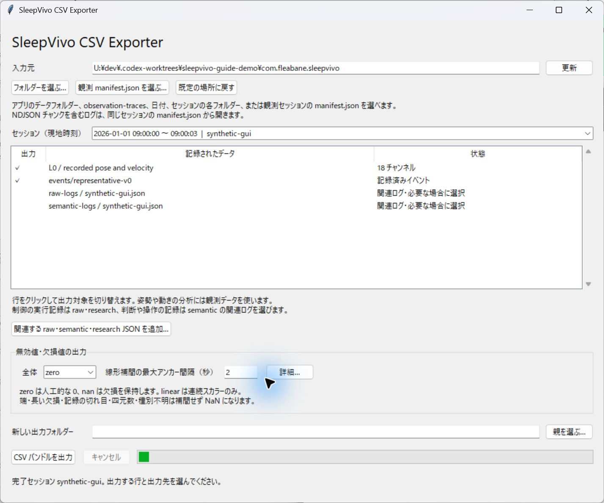
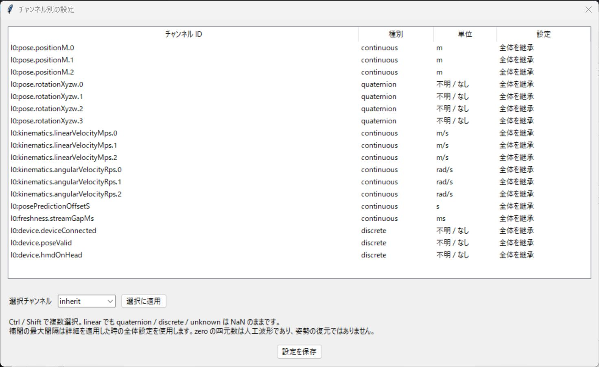

# SleepVivo CSV Exporter の使い方

完了した観測セッションを選び、時系列、イベント、要約、来歴を一つの CSV バンドルとして出力します。出力後はフォルダー一式を保管し、SurfCSViewer で `bundle.json` を開きます。

## 起動する

- Windows 実行ファイルがある場合は `SleepVivoCSVExporter.exe` を開きます。
- ソース一式がある場合は、Python 3.11 以降と Tkinter を用意し、Exporter のフォルダーで `python launch.pyw` を実行します。コマンドの引数なしで `python -m sleepvivo_csv` として起動することもできます。

## 入力元を選ぶ { #exporter-input }

1. 起動すると、既定の `%APPDATA%\com.fleabane.sleepvivo` にある、対応形式の完了セッションを検索します。
2. **セッション（現地時刻）** で開始・終了日時と ID を見て選びます。新たに記録が完了した場合は **更新** を押します。
3. 別の場所の記録を使うには **フォルダーを選ぶ…** を押します。アプリのデータフォルダー、`observation-traces`、その下の日付フォルダー、個別セッションのフォルダーを指定できます。**入力元** にパスを入力した場合は **更新** を押します。
4. 一つのセッションを直接指定するには **観測 manifest.json を選ぶ…** を押し、セッション直下の `manifest.json` を開きます。元の場所に戻るには **既定の場所に戻す** を押します。

主入力は観測セッションの `manifest.json`（`hmd_observation_session`、schema 2）です。コピーを使う場合は manifest と、参照先のチャンク・付属記録をディレクトリ構成ごと残します。NDJSON や gzip のチャンクは manifest を通して読み込みます。

## 出力する記録を選ぶ

一覧の行をクリックするか、行にフォーカスして **Space** を押すと出力対象のチェックが切り替わります。姿勢や動きには数値の観測データ、区間の照合にはイベント、比較には保存済み要約を選びます。対応しない形式や、L0 が保存されていない旨が表示された場合は、利用可能な他の記録を選びます。

同じセッションの関連ログを自動検出した場合、一覧に未選択で表示されます。制御の実行を調べる場合は raw・research、判断や操作を調べる場合は semantic の行を選びます。ファイルを直接指定する場合は **関連する raw・semantic・research JSON を追加…** を押し、同じ `session_id` を持つ schema 1 のセッション JSON を選びます。複数の関連ファイルは一度に選びます。開き直して選択すると、以前の手動選択は置き換わります。対応する観測セッションを先に開き、関連 JSON のログ種別・日付フォルダーを保ったまま同じドライブに置いてください。

[](../assets/img/researcher-exporter-session.jpg)

合成データの例です。観測時系列（L0）とイベントにチェックが入り、関連ログは未選択です。 画像をクリックすると原寸で開きます。

## 欠損の扱いを設定する

出力ソースを選んでから、**全体** で一括設定します。セッションの再選択や更新で個別設定が初期化されるため、最後にチャンネル別の設定を確認します。

| 設定 | 無効値・欠損値の出力 |
| --- | --- |
| `zero`（初期値） | 人工的に 0 を出力する。元の実測値と区別するには変換履歴を確認する。 |
| `nan` | `NaN` を残す。未処理の欠損を確認するときに使う。 |
| `linear` | 連続したスカラー量を、前後の有効な実測値から時刻に沿って線形補間する。 |

**線形補間の最大アンカー間隔（秒）** は、補間に使う前後の有効値の時刻差です。初期値は 2 秒です。正の値を指定します。端の欠損、間隔を超える欠損、記録の切れ目、四元数・離散値・種別不明の値は線形補間されず、`NaN` が残ります。四元数の 0 埋めで有効な向きが復元されるわけではありません。

チャンネルごとの設定は **詳細…** から変更します。

1. 選択した出力ソースに含まれるチャンネルから、変更したい行を選びます。**Ctrl** または **Shift** で複数選べます。
2. 補完方法を選んで **選択に適用** を押します。`inherit` を適用すると、個別設定を解除して全体設定に戻ります。
3. **設定を保存** を押して画面を閉じます。保存せずに閉じると、詳細画面での変更は破棄されます。個別設定は全体設定より優先されます。個別の `linear` は **選択に適用** を押した時点の最大間隔を使います。

[](../assets/img/researcher-exporter-channel-settings.jpg)

一覧で変更するチャンネルを選び、補完方法を適用してから保存します。

## 出力する

1. **新しい出力フォルダー** に、まだ存在しない場所を指定します。**親を選ぶ…** で親フォルダーを選ぶと、日時入りの新規フォルダー名が入ります。出力先は入力の共通ルートの外に置きます。
2. **CSV バンドルを出力** を押します。進み具合は画面下部で確認できます。途中で止めるには **キャンセル** を押します。キャンセルや失敗で、完成済みバンドルとしての出力は確定しません。
3. 完了メッセージの場所を開き、`bundle.json` と同じフォルダーの CSV 一式を確認します。

| 出力ファイル | 内容 |
| --- | --- |
| `bundle.json` | 表の一覧、UTC 原点、単位、元フィールド、参照元とハッシュ、実効設定 |
| `<表>.csv`・`<表>.rows.csv` | 時系列と、その行がどの記録に由来するかを示す来歴 |
| `events.csv`・`event-history.csv` | 記録済みイベントの最新 revision と、保存されたイベント履歴 |
| `summary.csv` | 保存済み集計の範囲・項目パス・元の型と値 |
| `transformations.csv` | 欠損セルの位置、理由、補完方法とアンカー |

イベントや要約がない場合は、その CSV は作成されません。CSV は UTF-8 BOM 付きです。数値表の時刻は共通原点からの経過秒で、各表の元の記録間隔を保ちます。詳しい分析上の注意は[データ構造](data-structure.md)をご覧ください。

## コマンドから出力する

ソースのフォルダーで実行します。`SESSION` は完了した観測セッションのフォルダー、`NEW_OUTPUT` はまだ存在しない出力フォルダーです。

```powershell
python -m sleepvivo_csv "SESSION" --list
python -m sleepvivo_csv "SESSION" "NEW_OUTPUT" --fill zero
```

| オプション | 用途 |
| --- | --- |
| `--list` | 数値チャンクを読み込まずにソース ID、チャンネル ID、単位や種別を確認する。出力先は省略できる。 |
| `--fill MODE` | 全体を `zero`、`nan`、`linear` のいずれかに設定する。省略時は `zero`。 |
| `--max-gap-s 2` | 線形補間の最大アンカー間隔を秒で指定する。 |
| `--source ID` | 出力ソースを選ぶ。複数の場合は繰り返し指定する。省略時は対応ソースを対象とする。 |
| `--related PATH` | 対応する関連ログ JSON を追加する。CLI では自動検出せず、複数の場合は繰り返し指定する。 |
| `--override CHANNEL_ID=MODE` | 個別の補完方法を `zero`、`nan`、`linear` のいずれかに設定する。複数の場合は繰り返し指定する。ID は `--list` の値を使う。 |
| `--help` | コマンドの引数とオプションを表示する。 |

```powershell
python -m sleepvivo_csv "SESSION" "NEW_OUTPUT" --source l0 --fill linear --max-gap-s 2 --override l0:pose.rotationXyzw.0=zero
```

## 読み込めないとき

- **セッションが見つからない** 場合は、観測フォルダーの構成、対応する manifest、記録の完了を確認します。
- **出力に失敗する** 場合は、エラーに出たソースを確認します。チャンクが未完了・破損している場合や、出力中に元ファイルが変わった場合はエラーになります。入力を読み込み直すか、必要のない対象を外して再試行します。
- **Viewer が NaN を報告する** 場合は、エラーに出た列と時刻を確認します。不要な列を Viewer で除外するか、分析方針に合う補完方法を選んで別のフォルダーへ再出力します。
