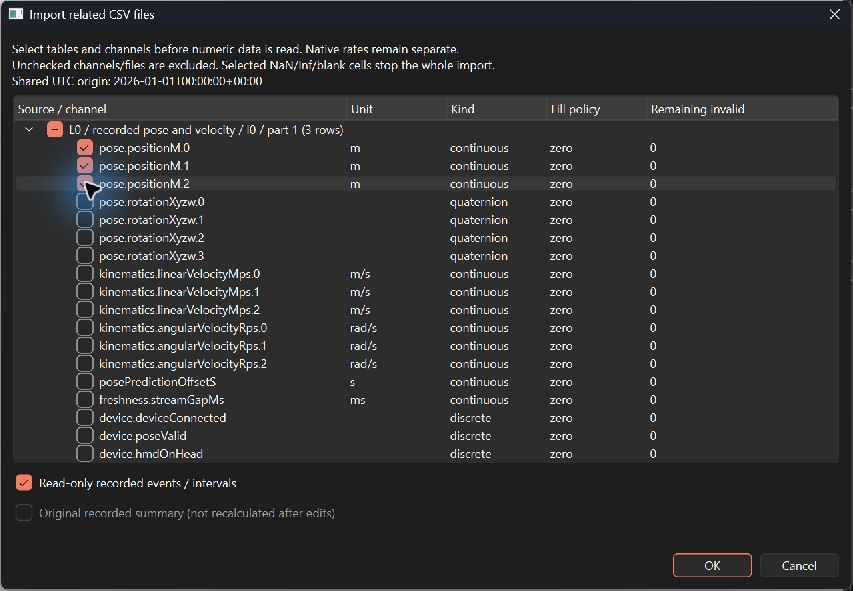
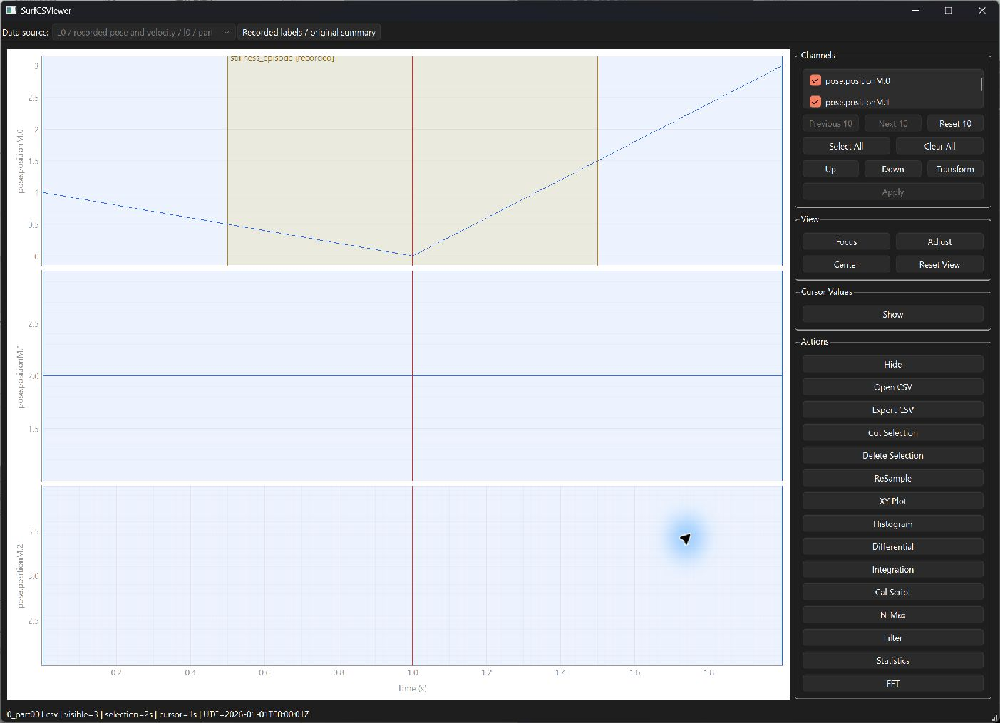

# SurfCSViewer の使い方

SurfCSViewer で CSV の波形を表示し、SleepVivo が記録したイベントの位置や元の集計を確認できます。この手順では、CSV バンドルの読込に対応した版を使います。

## SleepVivo のデータを開く

1. [SleepVivo CSV Exporter](csv-exporter.md) で観測セッションを出力し、`bundle.json` と CSV を同じ出力フォルダーに置きます。
2. SurfCSViewer を起動し、画面右側の **Open CSV** を押します。出力フォルダーにある `bundle.json` を選びます。
3. **Import related CSV files** で必要な表とチャンネルを選びます。イベントや要約がある場合は、ラベル・要約の読込も選べます。表ごとに選ぶことも、個別のチャンネルに絞ることもできます。少なくとも1つの数値チャンネルが必要です。
4. 読み込み後、上部の **Data source** で表示する表を切り替えます。たとえば、HMD の生観測と時間窓の特徴量はそれぞれの表として開きます。
5. **Recorded labels / original summary** から、記録済みラベルと元の要約を確認します。時刻が確定した表示対象のイベントは波形にも重なります。要約は保存済みの値で、画面の選択範囲を変えても再集計されません。

合成データの例です。位置の3軸と、一覧の下にある **Read-only recorded events / intervals** を選んでいます。 画像をクリックすると原寸で開きます。

!!! note "取込でエラーが出る場合"
    選択した数値に NaN・無限大・空欄・不正値があると今回の取込が止まり、以前の表示が残ります。エラーに表示されたファイル、行、列、時刻を確認し、不要な列を外すか Exporter で出力条件を変えます。古い Viewer で長い要約に関するエラーが出る場合は、集計を外して波形・イベントを読み込めます。

## 波形を確認する

合成データの表示例です。横軸は経過秒です。上段の淡い黄色の帯が記録済みのイベント区間で、赤い縦線はカーソルです。

| 操作 | 使い方 |
| --- | --- |
| チャンネルの表示 | 右側の **Channels** で表示したいチャンネルを選び、**Apply** で反映します。**Previous 10**・**Next 10** で表示するページを切り替え、**Reset 10** で先頭に戻せます。 |
| 時間軸の拡大・縮小 | 波形上でマウスホイールを回します。 |
| 時間軸の移動 | **Shift** を押しながらホイールを回します。 |
| 縦軸の拡大・縮小 | **Ctrl** を押しながらホイールを回します。 |
| 選択範囲 | 波形上の範囲の両端をドラッグし、調べたい区間に合わせます。**Focus** で選択区間に表示を合わせます。 |
| 値を確認する | 赤いカーソルを移動し、**Cursor Values** の **Show** を押すと近傍の値を表示できます。 |
| 1つの波形に絞る | 波形をダブルクリックします。もう一度ダブルクリックすると元の表示に戻ります。 |
| 表示を戻す | **Reset View** を押します。 |

波形の横軸はセッション共通の経過秒です。表を切り替えても、同じ時刻のイベントを照合できます。記録の切れ目や欠測の読み方は[データ構造](data-structure.md)をご覧ください。
