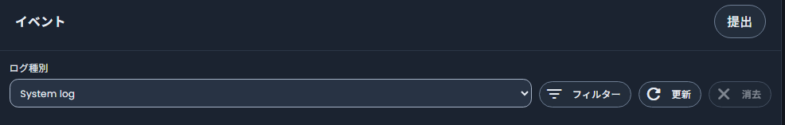

# サポート

!!! tip "不具合報告をお願いします"
    SleepVivo は現在 Pre-Alpha 版です。
    表示崩れ、ボタン反応が悪い、違和感、説明がわかりにくいなども改善に役立ちます。
    小さな点でもぜひ報告頂ければありがたいです。

## 連絡先

アプリの起動に失敗し、連絡先が表示された場合は、案内に沿って [X の @fleabane_haru](https://x.com/fleabane_haru) にDMを送れます。

問題が起きた場合や設定で迷った場合は、Discord でハルジオン @fleabane_haru に連絡してください。
また使い方が分かる方は[Github issue](https://github.com/omoi0kane/SleepVivo-public/issues)へ報告いただくのも歓迎です。

## アプリの動作をログで確認する

左メニューの「ログ」を開きます。ホームの「最近のログ」から「ログを見る」を押しても開けます。

アプリの動作を見るには「ログ種別」で「System log」を選びます。「フィルター」でイベントを絞り込み、「更新」で最新の内容を読み込めます。睡眠サポートの切り替わりは「Semantic log」、観測イベントは「Layer-2 event log」で確認できます。睡眠の結果やアンケートを見るには、[睡眠ログ](../user-guide/sleep-logs.md)を開いてください。

## アプリ内から調査用ログを提出する

問題が起きたときは、日付とログの種類を選んでアプリ内から調査用ログを提出できます。提出は任意で、利用には Research Program への参加が必要です。研究のための睡眠ログ要約とは別に、自分で提出を実行します。

1. 左メニューの「ログ」を開き、上部の「提出」を押します。「一般設定」の「調査用ログ提出」からも開けます。
2. 問題が起きた日付を選び、提出するログの種類を確認します。
3. 「提出」を押します。

ログには問題が起きた正確な時刻や操作の記録が含まれる場合があります。送信するログを選ぶ前に、[収集される情報](../research-program/collected-data.md) を確認してください。症状や再現手順は、上記の連絡先または GitHub issue で別途お知らせください。

## サポートへ連絡する前に

1. (可能であれば) 問題が起きた画面のスクリーンショットを保存してください
2. 直前に変更した設定や行った動作があれば、内容をメモします
3. SleepVivoとSteamVR を再起動します
4. 問題が解消していないかを確認します
5. VR 機器が SteamVR から見えているか確認します

## 連絡するときにあるとよい情報

1. 何をしようとしたか
2. 何が起きたか
3. 期待していた動き
4. 問題が起きた時刻
5. SleepVivo の画面名
6. 設定した入眠予定時刻と起床予定時刻
7. 可能であれば問題が起きた画面と、ログ画面のスクリーンショット

!!! note "報告は短くても大丈夫です"
    「この画面でボタンを押したら動かなかった」だけでも重要な情報です。
    Pre-Alpha 版では、細かい問題の報告が改善に直結します。

## よくある確認先

1. 起動しない、設定が反映されない、通知や音量がおかしい場合は [FAQ](faq.md) を確認してください。
2. 睡眠サポートの基本は [睡眠サポート](../user-guide/sleep-support.md) を確認してください。
3. スケジュールの入力は [スケジュール](../user-guide/scheduler.md) を確認してください。
4. Research Program の送信内容は [収集される情報](../research-program/collected-data.md) を確認してください。
