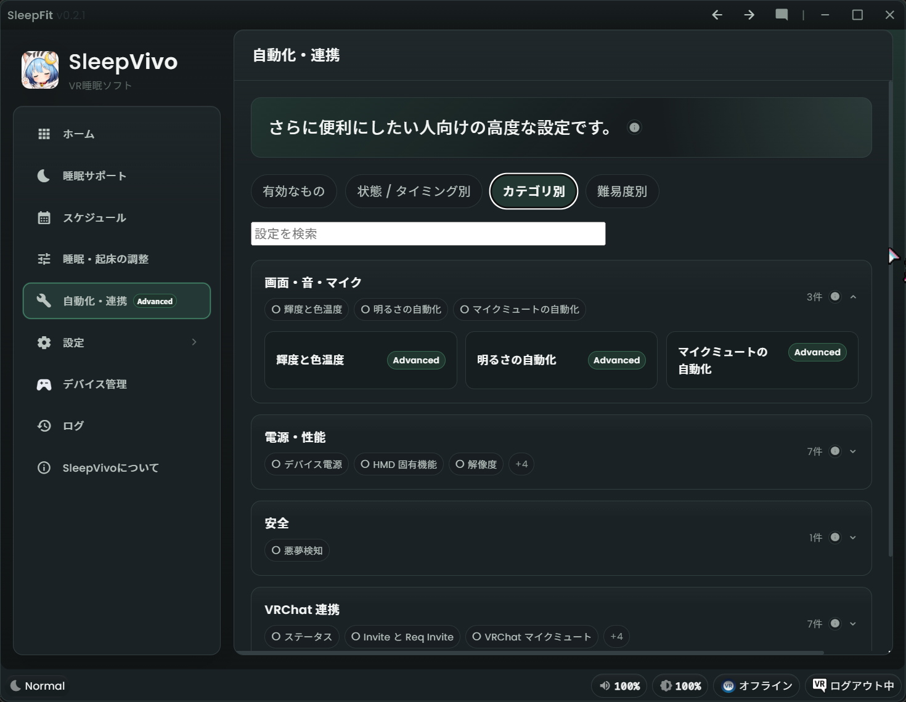
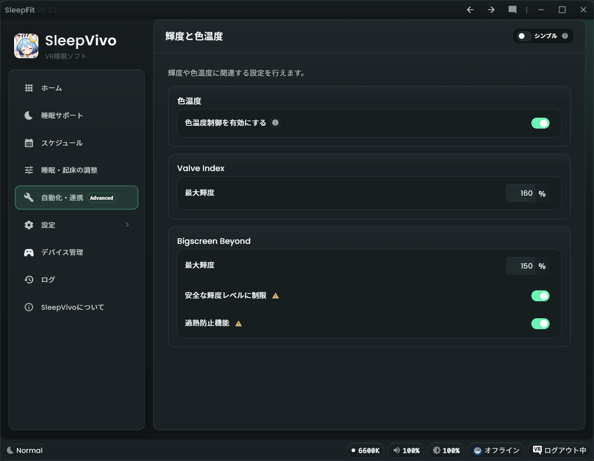
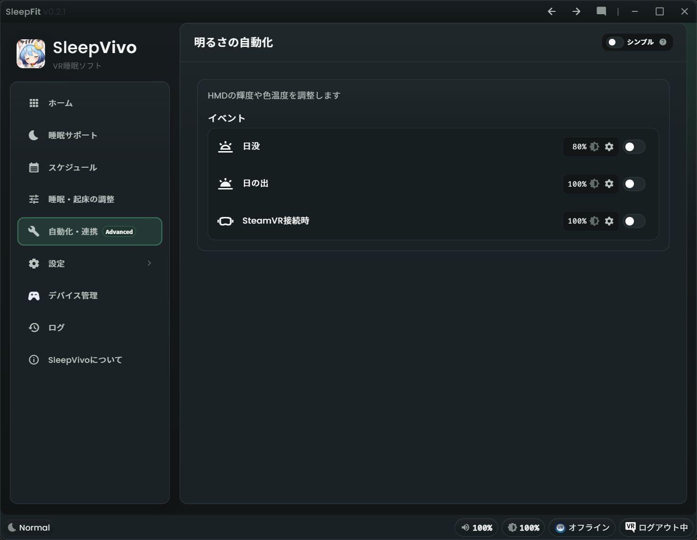
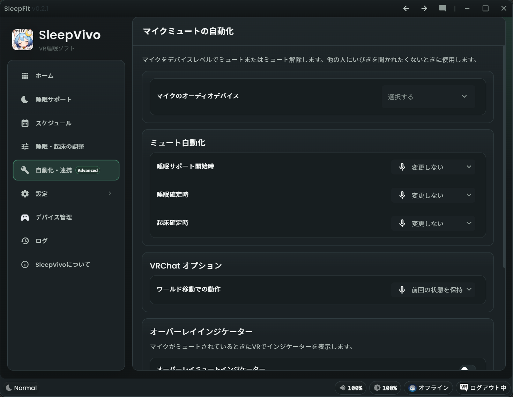
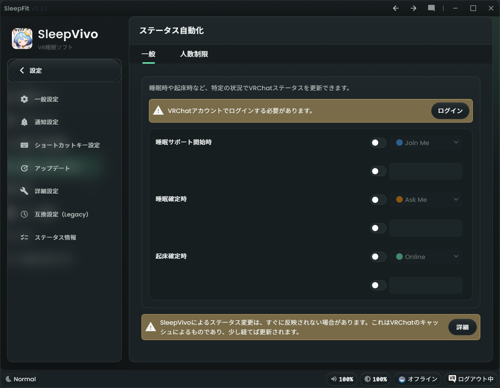
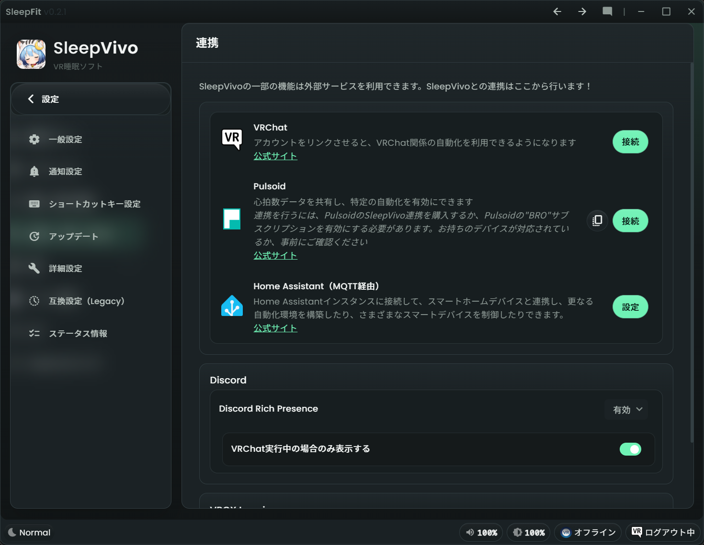
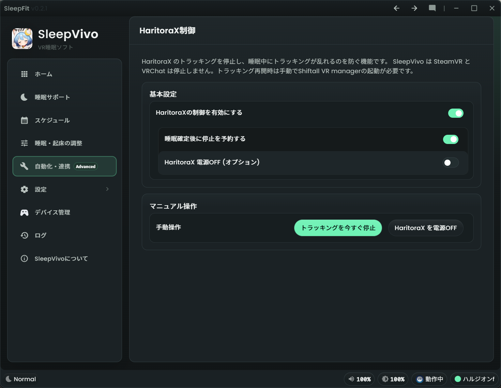

# 自動化・連携[advanced]

「自動化・連携」では、睡眠に合わせて機器の電源を切り替えたり、VRChatのステータスを変えたりできます。入眠・起床に使う明るさや音量は、[睡眠サポート](sleep-support.md)から調整できます。

## 索引機能

「自動化・連携」には、様々な設定を探すための検索機能があります。

* 「有効なもの」：現在有効な自動化を表示します
* 「状態 / タイミング別」：睡眠サポート開始時、睡眠確定時、起床確定時、予定・時刻ベース、イベントベース、常時参照のようなタグで検索します
* 「カテゴリ別」：画面・音・マイク、電源・性能、安全、VRChat 連携、外部連携のような分類で検索します
* 「難易度別」：コア機能(core)、上級者向け機能(advanced)、難しい機能(professional)のタグで検索します
* 「設定を検索」：設定名や説明に含まれる言葉で検索します

## 分類の見方

各項目には、Core、Advanced、Professional、Legacy などの表示があります。

1. Core は、睡眠体験の中心に近い設定です。
2. Advanced は、さらに便利にしたい人向けの高度な設定です。
3. Professional は、外部ツールやOSCなどの設定に慣れている方向けです。
4. Legacy は、以前の睡眠モードの条件や、旧音量自動化を引き継ぐときに使います。新しく音量を設定するときは、[睡眠・起床の調整](sleep-wake-settings.md)を開いてください。

## 画面・音・マイク

### 輝度と色温度 [core]

デバイス別の輝度上限、色温度制御、明るさ制御方式を設定します。
Valve Index や Bigscreen Beyond の輝度関連設定もここで行います。

### 明るさの自動化 [core]

日の出、日の入り、HMD 接続などをきっかけにした明るさの自動化です。
睡眠サポートの基本的な明るさ調整とは別に、環境にあわせた動きを設定したい場合に確認します。

### マイクミュートの自動化 [core]

ここで設定するのはシステムマイクのミュートです。VRChat内のマイクを切り替える場合は、下の「VRChat マイクミュート」を使います。睡眠ログに発話音やいびきの推定結果を残す場合は、[音声分析](settings.md#audio-analysis)を開いてください。

システムマイクの状態や、コントローラーバインドの挙動を設定します。
睡眠中や起床時のマイク状態を整理したい場合に確認します。

## 電源・性能

### デバイス電源 [core] { #device-power }

「電源の自動化」の「デバイス」タブで、条件と対象を選びます。たとえば、充電を始めたコントローラーの電源を切る設定や、SteamVRの起動・終了に合わせてベースステーションの電源を切り替える設定があります。[デバイス管理](device-manager.md)で付けたタグを使って、対象をまとめて選べます。

### Windowsの電源プラン

「電源の自動化」の「電源オプション」で、睡眠確定時と起床確定時に適用するWindowsの電源プランを選びます。たとえば、睡眠中は省電力のプランに切り替え、起床時に普段使うプランへ戻せます。

### HMD 固有機能 [core]

Bigscreen Beyond の fan / RGB など、対応 HMD 固有の機能を設定します。
対応していない HMD では効果がない場合があります。

### 解像度

睡眠確定時と起床確定時の SteamVR 解像度を設定します。
睡眠中の負荷を下げたい場合に確認します。

### フレームレート [advanced]

アプリごとのフレーム制限を設定します。
睡眠中や起床時の負荷を調整したい場合に確認します。

### ガーディアン [advanced]

SteamVR 境界のフェード距離自動化を設定します。
VR 空間での境界表示の見え方を調整したい場合に確認します。

### GPU [professional]

対応するNVIDIA GPUでは「パワーリミッター」で電力の上限を設定できます。MSI Afterburnerを使う場合は、先にAfterburnerでプロファイルを保存し、SleepVivoの「MSI Afterburner」タブで睡眠時・起床時に使うプロファイルを選びます。

### シャットダウン [advanced]

「シャットダウン処理」の「設定」で、電源を切る機器、SteamVRの終了、Windowsの電源操作を選びます。この画面から手動で実行することもできます。

自動で実行する場合は「自動化」タブを開き、条件を選びます。たとえば、睡眠が一定時間続いたときや、VRChatのワールドで途中から一人になり、その状態が一定時間続いたときに実行できます。ワールドに入ったときから一人だった場合、この条件は成立しません。

## 安全

### 悪夢検知 [advanced]

Pulsoid 連携時に、心拍数をもとにアラームや睡眠解除を行う設定です。
Pulsoid 連携が必要です。

## VRChat 連携

ステータス自動化など、VRChatアカウントを使う機能は、先に「外部連携」でログインします。マイクをOSCで操作する場合は、VRChat側でOSCとマイクのトグル設定を有効にします。

### ステータス [advanced]

睡眠サポート開始時、睡眠確定時、起床確定時の VRChat ステータスを設定します。
ステータスメッセージも変更できます。「人数制限」タブでは、ワールドの人数に応じてステータスを切り替える条件を設定できます。

### Invite と Req Invite [advanced]

Invite / Req Invite の自動処理や、プリセット切り替えを設定します。
招待リクエストの設定では、睡眠中に自動承認する相手を絞れます。

### VRChat マイクミュート [advanced]

OSCを使い、睡眠や起床に合わせてVRChat内のマイクをミュート、またはミュート解除します。画面にマイク状態が「不明」と出るときは、VRChatが起動しているか、VRChat側とSleepVivo側のOSCが有効かを確認してください。

### アバター変更 [advanced]

睡眠サポート開始時、睡眠確定時、起床確定時のアバター切り替えを設定します。

### グループ変更 [advanced]

表示中の VRChat グループを自動で切り替えます。

### Join 通知 [advanced]

プレイヤーの入退室通知と通知音を設定します。すべての入退室で通知が要らない場合は、フレンドや特定のプレイヤーなどに対象を絞れます。

### 睡眠アニメーション [advanced]

姿勢 OSC と foot lock の自動化です。
アバター側の対応や OSC 設定が関係します。

### VRChatアカウント連携について

ステータス変更などのアカウント連携は、VRChatの非公式連携を利用します。ログイン情報はお使いのPCに保存し、VRChatへの認証に使います。

## 外部連携

### 外部連携 [advanced]

「外部連携」で、使いたいサービスの設定を開きます。

| サービス | できること |
| --- | --- |
| VRChat | ログインすると、ステータス変更などのアカウント連携を使えます。 |
| Pulsoid | 対応する心拍計をPulsoidに接続し、SleepVivo側でも連携すると、画面下部で心拍数を確認できます。「悪夢検知」の設定もここから準備できます。 |
| Home Assistant | 「Home Assistant（MQTT経由）」でMQTTの接続先を設定します。Home Assistant側では、対応機器のバッテリー残量やSteamVRの状態を確認し、対応するベースステーションの電源などを操作できます。 |
| Discord | 「Discord Rich Presence」で、SleepVivoを活動として表示する条件を選べます。睡眠時やVRChatの実行中だけ表示するように設定できます。 |
| VRCX | VRCXに睡眠モードの切り替わりを記録するか選べます。 |

### HaritoraX制御 [advanced]
Shiftall HaritoraX によるフルボディトラッキングを停止する機能です。
VRChatではトラッカー喪失時には姿勢が固定されるため、睡眠中にトラッキングが乱れることを防いでくれます。

!!! warning "自動化・連携は上級者向けの設定です"
    本機能はShiftall VR Manager を停止することでトラッキングを停止させます。
    トラッキング再開には手動でShiftall VR managerを再起動する必要があります。

* 「HaritoraXの制御を有効にする」：SleepVivo による HaritoraX のトラッキング停止機能を有効にします
* 「睡眠確定後に停止を予約する」：寝落ちを検知した後、60秒後にトラッキングを自動で停止します。確認ウインドウがポップアップします
* 「HaritoraX 電源OFF」：有効にすると、トラッキング停止後に自動的に HaritoraX の電源がOFFになります。バッテリーが節約できます

### OSC 設定 [professional]

OSC の送信先、カスタムターゲット、OSC サーバー受信を設定します。
VRChat 連携や OSC 自動化を使う場合に確認します。

### OSC 自動化 [professional]

睡眠サポート開始時、睡眠確定時、起床確定時に任意の OSC スクリプトを送信します。
アバターや外部ツールに合わせた細かい制御をしたい場合に使います。

### コマンド実行 [professional]

睡眠サポート開始時、睡眠確定時、起床確定時に Windows コマンドを実行します。
実行するコマンドの内容によっては PC の状態に影響するため、内容がわかる場合だけ使ってください。
