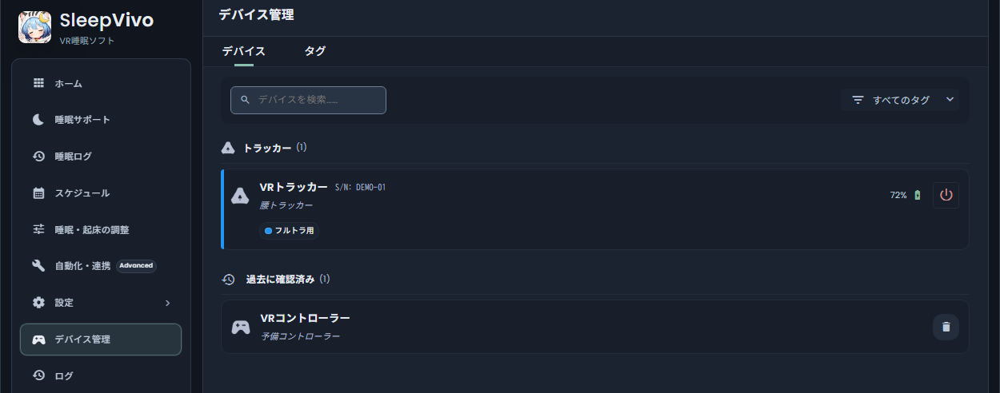

# デバイス管理

左メニューの「デバイス管理」で、SteamVRのコントローラー、トラッカー、ベースステーションなどを確認できます。機器を探して手動で操作するときや、自動化の対象をまとめるときに使います。

## 接続や充電の状態を見る

1. 「デバイス」タブを開きます。
2. 一覧で機器を探します。機器が多いときは、検索欄に名前を入力するか、タグで絞り込みます。
3. 機器がバッテリー情報を送っている場合は、残量と充電中かどうかを確認できます。「過去に確認済み」には、過去に検出され、現在は接続されていない機器が表示されます。

画像の機器名と残量は例です。

## 機器の電源を操作する

電源ボタンが表示されているコントローラーやトラッカーは、一覧から電源をオフにできます。SleepVivoから制御できるベースステーションは、オンとオフを切り替えられます。

電源をまとめて切り替えたいときは、「自動化・連携」の[デバイス電源](automations.md#device-power)を開きます。

## 名前やタグで整理する

1. 「タグ」タブで、「予備トラッカー」など、用途が分かる名前のタグを作ります。
2. 「デバイス」タブに戻り、機器の行を押します。必要に応じてニックネームを付け、作成したタグを割り当てます。
3. 一覧の絞り込みや、電源の自動化で対象を選ぶときに、そのタグを使います。

## 補足

残量表示や電源操作の可否は、機器と接続環境によって異なります。HMDにはこの画面の電源ボタンは表示されません。
