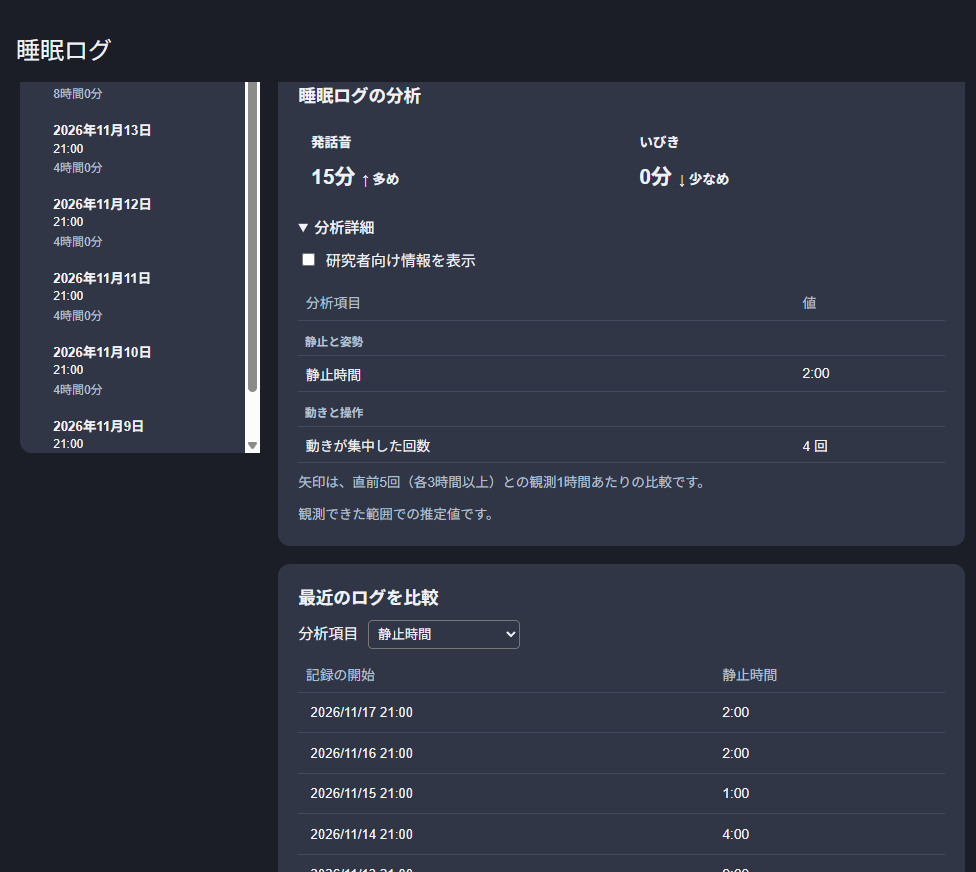

# 睡眠ログ

起床後に、今回の記録を見たり、過去の自分の記録と比べたりできます。睡眠ログの閲覧とアンケートは、研究への参加をオフにしていても使えます。

## 今回の記録を見る

1. デスクトップの「概要」で「睡眠ログを見る」を選びます。
2. 履歴から見たい日時を選びます。
3. 選んだログの開始・終了時刻や「睡眠ログの分析」を確認します。

「記録中」は睡眠ログの記録が続いている状態です。「集計中」と表示されている間も、起床後のアンケートに回答できます。

## 起床後のアンケートに答える

「概要」に表示されたアンケートを開き、寝つき、睡眠の満足度、起床後のすっきり感を、それぞれ1〜5で選んで保存します。回答は任意です。画面を閉じたあとでも、「睡眠ログ」で記録を選んで回答できます。保存済みの回答も同じ画面で編集できます。

VR 内で答えるときは、[VR Overlay のアンケート](vr-overlay.md#post-wake-survey)を開きます。回答はデスクトップでも同じ睡眠ログに表示されます。

## 過去の記録と比べる

「最近のログを比較」で分析項目を選ぶと、比較できる最近のログを一覧で確認できます。選んだログに「↑ 多め」「↓ 少なめ」が出る場合は、十分に観測できた直前5回のログ（各3時間以上）と、観測1時間あたりの値を比べた結果です。

画像はサンプルデータでの表示例です。

## 分析の見方

発話音やいびきの時間は、マイクで分析できた範囲での推定値です。「0分」は、分析した範囲で該当する音が見つからなかったことを示します。「音声分析なし」など、値が出ていない項目には、分析できるデータがありません。マイクを確認するには[音声分析の設定](settings.md#audio-analysis)を開いてください。

HMDの動きや静止の集計は、装着中に観測できた範囲を示します。HMDを外したあとの睡眠や睡眠段階は、この画面からは分かりません。
