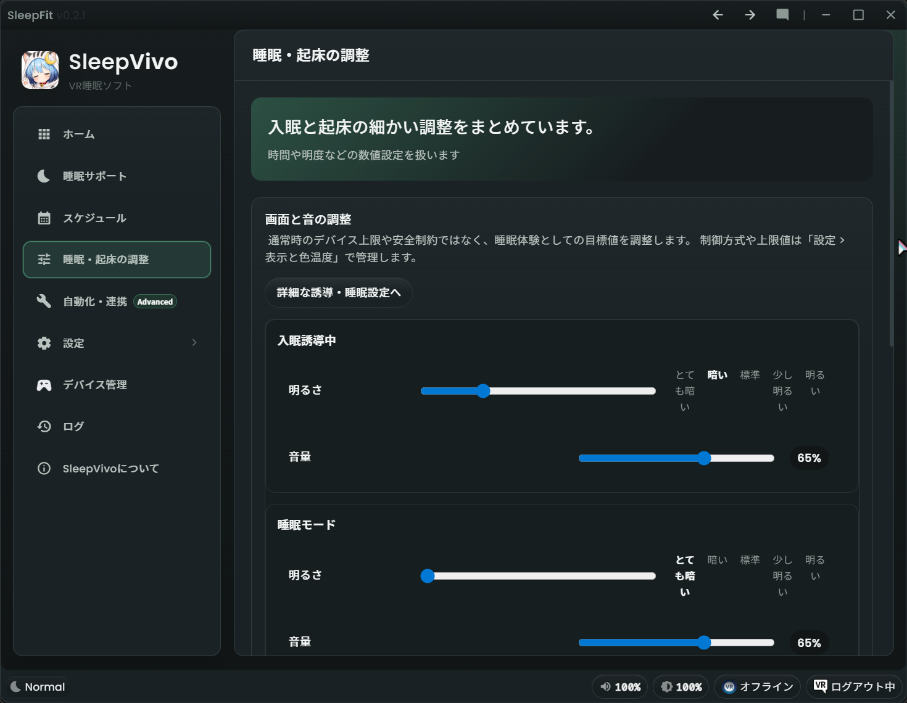
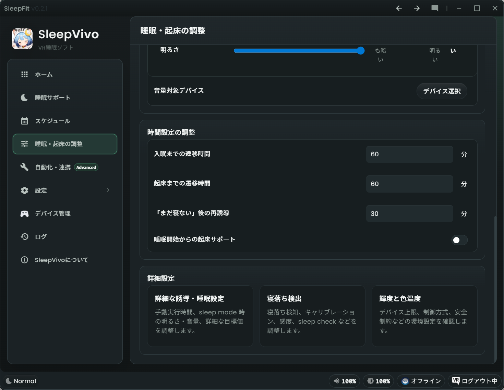
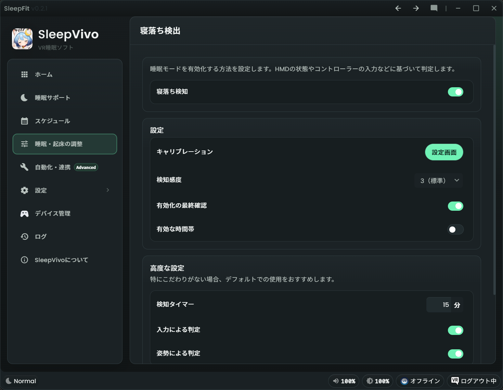
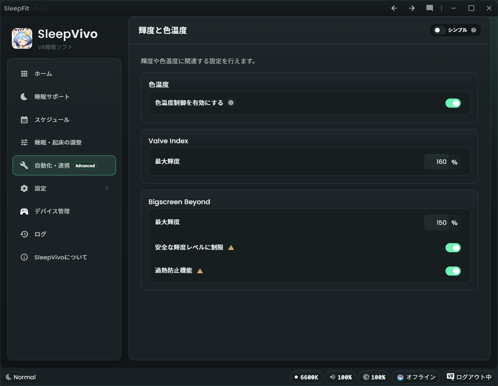

# 睡眠・起床の調整（詳細設定）

「睡眠・起床の調整」は、入眠サポート、寝落ち検知、起床サポートを細かく調整するためのページです。
左メニューの「睡眠・起床の調整」に対応します。

まずは [睡眠サポート](sleep-support.md) の基本設定を使い、明るさ、音量、時間が合わないと感じたらこのページで調整してください。
SleepVivo 全体の流れは [SleepVivo の基本機能](basic-functions.md) を確認してください。

!!! tip "迷ったら標準のまま"
    慣れるまでは、細かい数値を大きく変えず、まずプリセットを使うことをおすすめします。
    詳細設定は眠りにくい、明るすぎる、音が大きいなど調整したいところがあった時に利用してください。

## 画面と音の調整

「画面と音の調整」では、睡眠中のVRヘッドセットの画面明るさや色温度、音量などの目標値を調整します。
通常時のデバイス上限や安全制約ではなく、寝るとき・眠っているとき・起きるときにどのくらい変化させるかを決める場所です。

「入眠サポート中」「睡眠モード」「起床サポート中」については、 [SleepVivo の基本機能](basic-functions.md) と [睡眠サポート](sleep-support.md) を参照してください。

* 「明るさ」：各モード中の明るさを選びます
* 「色温度」：画面色を暖色寄りにするか、寒色寄りにするかを調整できます（色温度制御を有効にしている場合のみ表示されます）
* 「音量」は、入眠開始前の音量を100%として設定します。起床サポートでは、入眠前に記録した音量へ戻します。

色温度はBigscreen Beyond、Valve Indexなどの一部のヘッドセットでのみ有効にできます。
有効にする場合は、 [自動化・連携[advanced]](automations.md) ＞輝度と色温度 から設定してください。

### 音量対象デバイス { #audio-output-devices }

音量変更を適用するオーディオ再生デバイスを選びます。
音量の自動変更の対象になるほか、デスクトップGUIやVRオーバーレイのスライダーから調整ができるようになります。

1. 「音量対象デバイス」から「デバイス選択」を押します
2. SleepVivo の音量変更を適用したい再生デバイスの「＋」ボタンを押します

## 時間設定の調整

たとえば、起床予定を 7:00、起床までの遷移時間を30分にすると、予定どおりに動作した場合は 6:30 から画面や音の調整が始まります。

「時間設定の調整」では、入眠サポートと起床サポートにかける時間を設定します。

* 「入眠までの遷移時間」：入眠予定時刻までに何分かけて入眠サポートを進めるかを決めます
* 「起床までの遷移時間」：起床予定時刻までに何分かけて起床サポートを進めるかを決めます
* 「`まだ寝ない` 後の再誘導」：入眠サポート中、`まだ寝ない` を押したあと、何分後に再び入眠サポートが開始するかを決めます
* 「睡眠開始からの起床サポート」： ON にすると、睡眠モードに入ってから一定時間後に起床サポートを開始します。

!!! tip "睡眠開始からの起床サポート"
    通常は「スケジュール」から就寝・起床時刻を設定して使うため、この機能はデフォルトでOFFになっています。
    もし入眠を手動で行うような場合にはこの機能を使ってください。

## 詳細設定から移動できるページ

ページ下部の「詳細設定」には、さらに細かい設定先があります。
慣れるまでは無理に変更する必要はありません。

### 詳細な誘導・睡眠設定

入眠サポートプロファイルと起床サポートプロファイルの詳細を調整します。

1. 明るさを変更するかどうか。
2. シンプル明度モードで使う「簡易明度 (%)」。
3. 高度な明度モードで使う「ソフトウェア明度 (%)」と「ハードウェア明度 (%)」。
4. 色温度制御を使う場合の「色温度 (K)」。
5. 入眠サポートや睡眠中に使う「音量 (%)」。起床サポートでは音量の目標値を個別に指定せず、入眠前の音量に戻します。
6. 「手動実行時の遷移時間 (秒)」と「自動実行時の遷移時間 (秒)」。
7. 睡眠モード時の画面制御、音量、遷移時間。

### 寝落ち検知

「寝落ち検出」で、HMDの動きを使う寝落ち検知を設定できます。キャリブレーションが必要と表示されたら、SteamVRを起動してHMDを接続し、「キャリブレーション開始」を押します。画面の指示に従って、普段眠るときの姿勢で測定してください。

まだ起きているときに入眠確認の通知が出たら、その通知で取り消せます。検知の感度や確認通知の設定は「寝落ち検出」で調整できます。

### 起床判定方式

通常は「Smart mode（推奨）」を使います。起床サポートを予定時刻に合わせて始めるか、睡眠開始から一定時間後に始めるかは、「睡眠・起床の調整」で設定します。

以前の睡眠モードの解除条件を使っていた方は、「設定」から「互換設定（Legacy）」を開き、「旧睡眠判定」で「Legacy mode」を選ぶと、その条件を確認できます。

### 輝度と色温度

デバイス上限、制御方式、安全制約などの環境設定を確認するページです。

1. 色温度制御を有効にするか確認します。
2. Valve Index の最大輝度を確認します。
3. Bigscreen Beyond の最大輝度や安全関連の設定を確認します。

